<div align="center">




<br/>

[](#about)
[](#projects)
[](#stack)
[](#connect)


</div>

## About

<table>
<tr>
<td width="65%" valign="middle">

```python
class Keerthika:
    role     = "B.Tech CSE student @ ANITS"
    focus    = ["Machine Learning", "AI"]
    building = ["Journey", "AutoWorth"]
    backend  = ["Supabase", "PostgreSQL"]
    loves    = "turning raw data into clear insights"
    contact  = "vasireddikeerthika9@gmail.com"
```

Built **Journey**, an ML-powered railway ETA predictor, for **Smart India Hackathon 2026**.
Learning something new in ML & AI every week.

</td>
<td width="35%" align="center" valign="middle">


</td>
</tr>
</table>

<div align="center"></div>

## Projects

<table>
<tr>
<td width="50%" valign="top">

#### Journey
*Dynamic railway ETA prediction*

LightGBM model predicting station-level train delays, with a Next.js + Supabase app in English, Telugu and Hindi.

`LightGBM` `Next.js` `Supabase`

[Code](https://github.com/vasireddikeerthika/Journey) · [Live demo](https://journey-ijym.vercel.app)

</td>
<td width="50%" valign="top">

#### AutoWorth
*Used car price prediction*

Random Forest model (R² 0.91) with a 5-tab Streamlit app for analysis and live price estimates.

`Random Forest` `Streamlit` `R² 0.91`

[Code](https://github.com/vasireddikeerthika/autoworth) · [Live app](https://autoworth.streamlit.app)

</td>
</tr>
<tr>
<td width="50%" valign="top">

#### Retail Customer Segmentation
*Clustering and classification*

K-Means clustering and a Random Forest classifier to segment customers and flag high-value shoppers.

`K-Means` `Random Forest`

[Code](https://github.com/vasireddikeerthika/Retail-Customer-Segmentation)

</td>
<td width="50%" valign="top">

#### Call Center Dashboard
*Performance analytics*

Interactive Excel dashboard with PivotTables, slicers and KPI tracking.

`Excel` `PivotTables` `KPIs`

[Code](https://github.com/vasireddikeerthika/call-center-performance-dashboard)

</td>
</tr>
</table>

<div align="center"></div>

## Stack

**Languages & data**


**ML & visualization**


**Backend & tools**


**Analytics**


<div align="center"></div>

## Stats

<p align="center">
  
  
</p>

<div align="center"></div>

## Connect

[](https://www.linkedin.com/in/vasireddi-keerthika)
[](mailto:vasireddikeerthika9@gmail.com)

<br/>



<p align="center">
  
</p>
